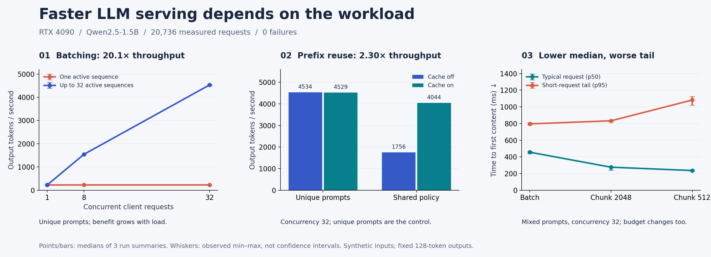

# LLM Inference Analysis

**Have you ever wondered whether a faster AI server means a shorter wait for every user?** Imagine a group of people using the same AI assistant: some send a short question, while others paste a long document. How should the server share its GPU—and could an optimization help the typical user while making the slower requests wait longer?

To investigate, I ran a controlled experiment comparing three ways to serve requests: processing them together (batching), reusing work on shared prompt beginnings (prefix caching), and processing long inputs in smaller pieces (chunked prefill). The goal was to measure both how much text the server produced and how long users waited for the first response.

Using vLLM and Qwen2.5-1.5B-Instruct on one NVIDIA RTX 4090, I tested unique prompts, a shared policy, and a mix of short and long inputs. The full experiment covers **162 cells, three repetitions, and 20,736 measured requests with zero failures**. The most interesting finding: one configuration improved typical first-response latency while worsening the wait for slower short requests.



At 32 concurrent requests:

- **Batching:** 226 → 4,534 output tokens/s on unique prompts, a **20.1×** gain over a one-active-sequence baseline.
- **Prefix caching:** 1,756 → 4,044 output tokens/s on shared prompts, a **2.30×** gain; unique prompts showed essentially unchanged throughput.
- **A real trade-off:** on mixed prompts, a 512-token chunk budget reduced median first-content latency from **456 to 236 ms**, while short-request p95 worsened from **796 to 1,082 ms** and throughput fell about **9.8%**.

These are medians of three run summaries on one GPU and one small model. The chunk comparison changes both prefill policy and token budget. The study evaluates serving performance on synthetic inputs; it does not evaluate answer quality or execute agent tools.

**[Read the plain-English research report →](docs/RESEARCH_REPORT.md)**

[Detailed methodology and GPU instructions](docs/METHODOLOGY.md) · [Published evidence](docs/results/README.md) · [Vector figure](docs/figures/research_highlights.svg)

## What this project demonstrates

The work connects a research question to hypotheses, controlled comparisons, a streaming HTTP measurement tool, repeated GPU experiments, and an interpretation that includes negative results. The benchmark replays identical prompts across configurations, varies concurrency, records individual request timings, and preserves enough public evidence to independently check the reported metrics.

The code uses vLLM's existing serving features. The contribution here is the experiment design, measurement pipeline, and analysis of when those features help.

## Inspect the results without a GPU

```bash
git clone https://github.com/chaohsuchen/LLM-Inference-Analysis.git
cd LLM-Inference-Analysis
python3 -m venv .venv
.venv/bin/python -m pip install -e .
.venv/bin/python scripts/validate_evidence.py
.venv/bin/python scripts/research_figure.py
.venv/bin/python -m unittest discover -s tests -v
```

The figure script rebuilds both PNG and SVG directly from the published CSV. Evidence validation checks file hashes, the complete experiment matrix, and every request-derived summary against the compressed request records.

## Repeat the GPU experiment

On a Linux machine with an allocated NVIDIA GPU:

```bash
bash scripts/setup_cuda.sh
PROFILE=smoke sbatch --partition=YOUR_PARTITION --gres=gpu:YOUR_GPU:1 scripts/slurm.sbatch
# Inspect the smoke run before submitting the full experiment.
PROFILE=full sbatch --partition=YOUR_PARTITION --gres=gpu:YOUR_GPU:1 scripts/slurm.sbatch
```

The SLURM file retains the partition and GPU defaults used for this study; override them for your cluster. Installation resolves dependencies today; the [recorded environment](docs/results/environment.json) and [package inventory](docs/results/pip-freeze.txt) document the measured run. Its model revision was not pinned, which limits exact replication. See the [methodology](docs/METHODOLOGY.md) for workload definitions, configurations, measurements, and limitations.

## Repository contents

| Path | Purpose |
|---|---|
| `lab/` | Deterministic workloads, real HTTP benchmark, GPU runner, full-run report export |
| `scripts/` | CUDA setup, SLURM submission, evidence validation, reproducible figure |
| `tests/` | Offline metric and export checks |
| `docs/RESEARCH_REPORT.md` | Findings, reasoning, limitations, and next experiments |
| `docs/results/` | Compact measured evidence with hashes and provenance |
| `docs/figures/` | Generated research figure in PNG and SVG |

Model weights, virtual environments, caches, local logs, and complete local run directories are excluded from Git. The public evidence excludes prompts, generated response samples, machine UUIDs, and local executable paths.
